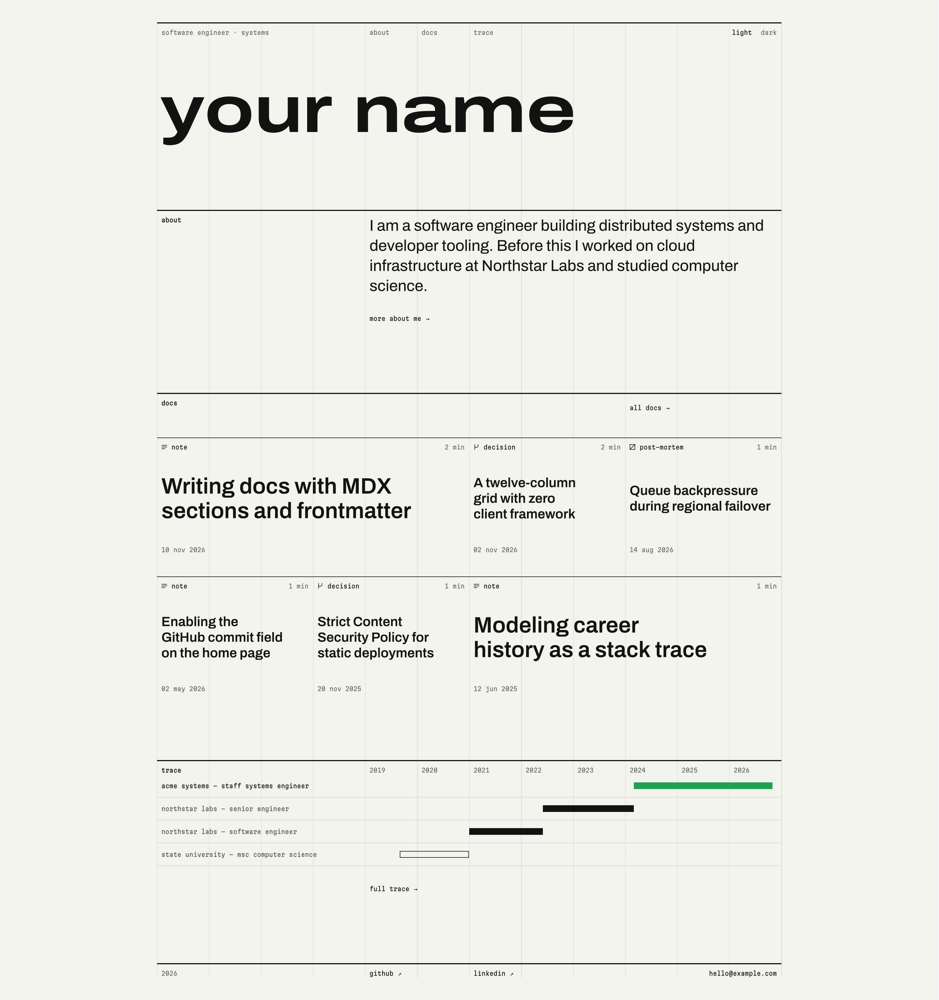
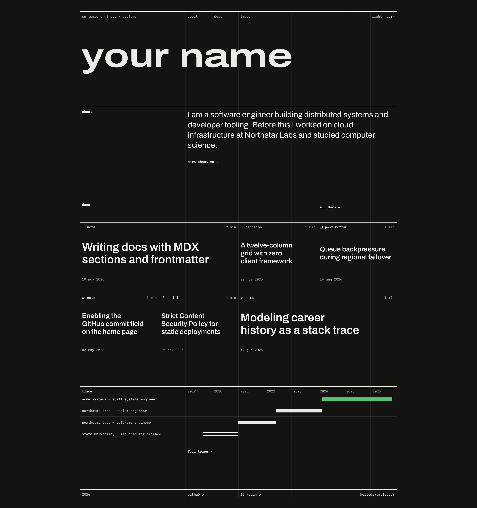
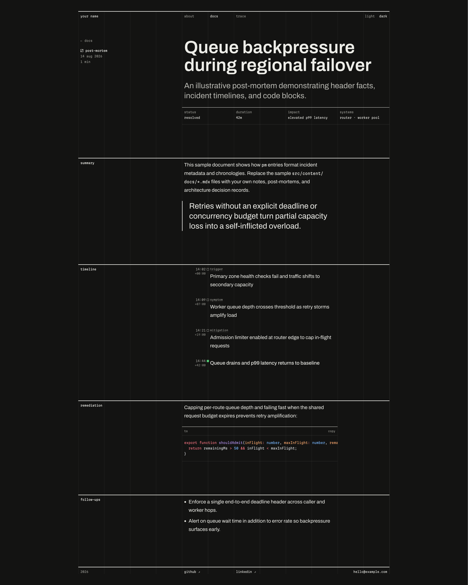
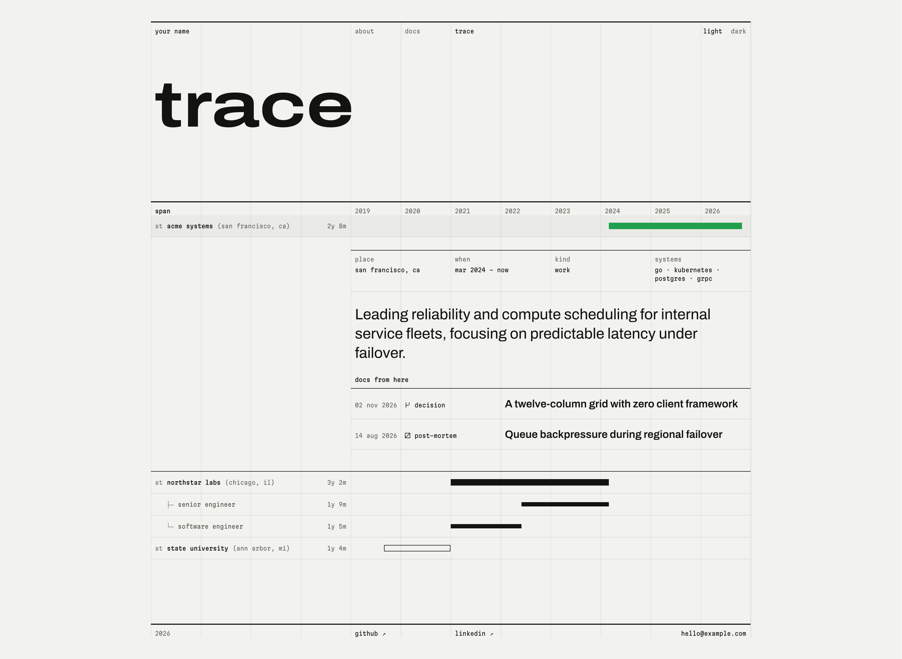

# astro-structural

An open-source [Astro](https://astro.build) personal website and engineering log template inspired by Wim Crouwel and Dutch structural functionalism.

**[Live Demo](https://astro-structural.arpitflex.workers.dev)**

Built on a visible twelve-column CSS subgrid with zero client-side UI frameworks, `light-dark()` ink-on-paper theming, build-time Content Security Policy hashes, self-hosted variable fonts, and structured MDX content (`pm`, `adr`, `note`).

## Preview

| Home (light)                                               | Home (dark)                                              |
| ---------------------------------------------------------- | -------------------------------------------------------- |
|  |  |

| Post-mortem (`pm` with `FactGrid` & `Timeline`)                         | Trace explorer (expanded stack frame)                                     |
| ----------------------------------------------------------------------- | ------------------------------------------------------------------------- |
|  |  |

## Features

- **Visible 12-column grid**: Every rule, label, prose block, code fence, table, and timeline aligns to CSS grid tracks (`design-system/`).
- **Zero client framework**: Static HTML/CSS with native cross-document `@view-transition` and three tiny inline behaviors (pre-paint theme switcher, `/docs` kind filter, code copy button).
- **Engineering docs collection**: Type-checked MDX in `src/content/docs/` supporting post-mortems (`pm`), architecture decision records (`adr`), and notes (`note`), with automatic reading time, header `facts`, and `<Timeline />` chronologies.
- **Career trace explorer**: Eight-year career/study bar timeline (`src/data/trace.ts`) with expandable organization drawers and linked documents (`trace: <id>`).
- **Optional GitHub commit field**: Build-time 48-week contribution calendar aggregated across one or more GitHub accounts (`GITHUB_TOKEN`).
- **SEO & security**: Generated `rss.xml`, `sitemap-index.xml`, `robots.txt`, JSON-LD (`Person`, `WebSite`, `TechArticle`, `CollectionPage`), and build-time CSP (`security.csp`).

## Quick start

```sh
# Create a new project from this template
pnpm create astro@latest -- --template arpitflex/astro-structural

# Install dependencies and start the dev server (http://localhost:4321)
pnpm install
pnpm dev

# Type-check and build static output to dist/
pnpm run check
pnpm run build
pnpm preview
```

Node 26 and pnpm 12 are pinned in `mise.toml` and `package.json` (`packageManager`).

## Customizing the template

You can personalize the entire site by editing five places—no component or page template changes required:

1. **`astro.config.mjs`**: Set `site` to your production URL (used for canonical URLs, RSS, sitemap, and `robots.txt`).
2. **`src/data/site.ts`**: Update `name`, `fullName`, `role`, `jobTitle`, `company`, `tagline`, `description`, `email`, `socials` (any label/handle/URL list), `nav`, and optional `githubUsers`.
3. **`src/data/about.ts`**: Update `homeStatement`, `description`, `now`, `before` paragraphs, and `colophon`.
4. **`src/data/trace.ts`**: Replace the sample work and study periods. Omit `end` on your current role to highlight it with `--now` green.
5. **`src/content/docs/*.mdx`**: Replace the sample guide/example docs with your own post-mortems, ADRs, and notes.

## Writing a doc

Add `src/content/docs/<id>.mdx`. Frontmatter is validated by `src/content.config.ts`:

```mdx
---
kind: pm # pm | adr | note
title: Queue backpressure during regional failover
date: 2026-08-14
dek: One sentence under the title.
trace: acme # optional; matches an id in src/data/trace.ts
facts: # optional ordered header metadata
  status: resolved
  duration: 42m
timeline: # optional; render with <Timeline events={frontmatter.timeline} />
  - { time: '14:02', delta: '+00:00', tag: trigger, text: Primary zone health checks fail }
  - { time: '14:44', delta: '+42:00', resolved: true, text: Latency returns to baseline }
---

import Timeline from '@components/content/Timeline.astro';

## summary

Every `##` heading opens a section on the grid. Keep interface headings lowercase.

## timeline

<Timeline events={frontmatter.timeline} />
```

## GitHub commit field (optional)

To enable the 48-week contribution grid on the home page:

1. Add one or more GitHub usernames to `githubUsers` in `src/data/site.ts`.
2. Copy `.env.example` to `.env` and set `GITHUB_TOKEN` with public profile read access.
3. Add `GITHUB_TOKEN` to your CI/deployment environment variables.

When `githubUsers` is empty or `GITHUB_TOKEN` is unset, the build omits the commit field cleanly.

## Project structure

```text
design-system/         CSS tokens, ag-* classes, and browser-viewable guideline cards
src/content/docs/      MDX documents (filename becomes /docs/<id>)
src/content.config.ts  Zod schema for the docs collection
src/data/              site.ts, about.ts, trace.ts
src/lib/               Build-time helpers (dates, docs, trace, GitHub, schema, satteri sections)
src/scripts/           Pre-paint theme-init.js injected into <head>
src/components/        Structural Astro components (no scoped styles)
src/layouts/           Document shell (head, meta bar, main, footer)
src/pages/             Routes plus rss.xml.ts and robots.txt.ts
public/                Self-hosted fonts, geometric icons, and _headers
```

## Design system

The full visual specification is in [`design-system/README.md`](design-system/README.md), with standalone HTML reference cards under [`design-system/guidelines/`](design-system/guidelines/).

## Security headers & CSP

`astro.config.mjs` enables `security.csp` so Astro computes script hashes at build time and emits a `<meta>` policy into every HTML page. Inline style attributes remain allowed for Shiki syntax tokens and trace lane offsets (Astro's expected build-time Shiki warning applies). Because CSP is only applied in `build` and `preview`, verify script changes with `pnpm run build && pnpm preview`.

Additional HTTP response headers (such as `frame-ancestors 'none'` and immutable asset caching) live in `public/_headers`.

## Deployment

`pnpm run build` emits pure static files in `dist/` with no trailing slashes (`trailingSlash: 'never'`), ready for Vercel, Netlify, GitHub Pages, or Cloudflare.

### Optional: Cloudflare Workers static assets

`wrangler.jsonc` and `.github/workflows/deploy.yml` provide an optional Cloudflare Workers setup:

1. Update `"name"` (and optional `"routes"`) in `wrangler.jsonc`.
2. Deploy locally with `pnpm run deploy`, or configure `CLOUDFLARE_API_TOKEN` and `CLOUDFLARE_ACCOUNT_ID` in GitHub Secrets and run the `deploy-cloudflare` workflow.

Default CI (`.github/workflows/ci.yml`) runs `pnpm run check` and `pnpm run build` on every push and pull request with no extra secrets required.

## License & credits

- Code & template: [MIT License](LICENSE).
- Fonts: [Archivo](public/fonts/Archivo-OFL.txt) (Omnibus-Type) and [Martian Mono](public/fonts/MartianMono-OFL.txt) (Evil Martians), self-hosted Latin subsets under the SIL Open Font License 1.1.
- Created by [Arpit Agrawal](https://arpitagrawal.dev) — originally built for his personal website.
